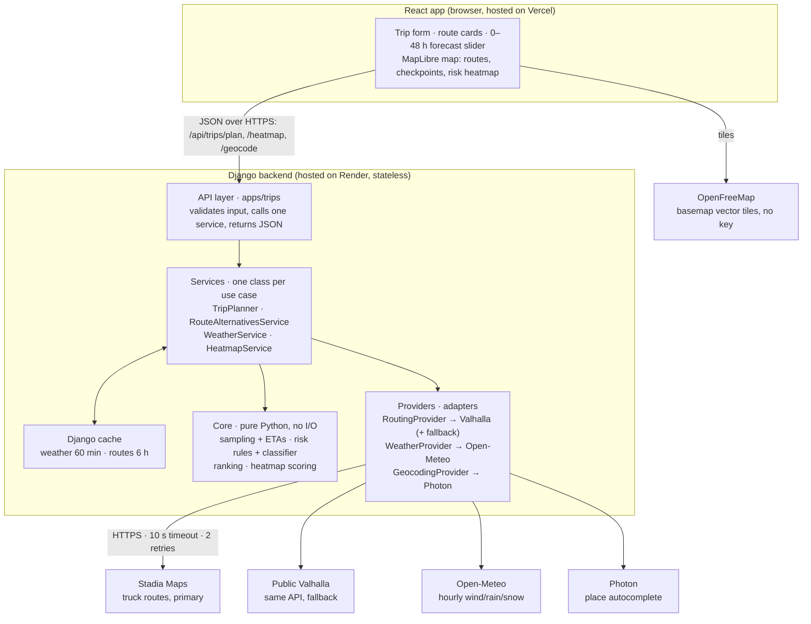

# 🌦️ Weather-Aware Truck Routing Assesment

A full-stack app for **truck drivers** that turns a trip (origin, destination,
departure time, load weight) into **3 routed options** scored for weather risk
at every checkpoint's estimated arrival time, a **recommended route** with a
one-line reason, and a **0–48 h risk heatmap** along the corridor.

Built with **Django + Django REST Framework** (backend) and **React + Vite +
MapLibre GL** (frontend). Routing runs on Stadia Maps' hosted Valhalla (with a
public Valhalla fallback), weather on Open-Meteo, geocoding on Photon, and map
tiles on OpenFreeMap — every service is free (free tier or open source).

---

## ✨ What it does

**Inputs**
- Origin and destination (autocomplete via Photon)
- Departure date/time
- Load weight (lb)
- Checkpoint sampling interval (10 / 25 / 50 miles)

**Outputs**
- **3 distinct truck routes** (e.g. "Fastest", "Prefers state roads", "Western
  detour"), each with distance, duration and arrival time.
- **Checkpoints** along every route with ETA, wind, rain, snow and a risk
  level, shown as coloured map markers with popups.
- **A recommended route** plus a one-line reason, e.g. "0 severe miles vs 42
  on the Fastest route" — or a red "do not travel" banner if every route hits
  No Travel conditions.
- **A weather heatmap** over the trip corridor, driven by a 0–48 h slider with
  49 precomputed frames (no network calls while dragging) and a truck marker
  showing where each route will be at that hour.

**Trip assumptions**
- Truck weight sent to the router = load weight + an assumed empty-truck
  weight (`ASSUMED_EMPTY_TRUCK_LB`, default 35,000 lb).
- Risk uses sustained wind, not gusts (gusts are shown but don't drive risk).
- Rain rate = `rain + showers`; snow rate = `snowfall`, converted to inches.
- Driver rest breaks are not modelled — see `README.md` §12 for this and
  every other open-brief decision.

---

## 🧠 Weather-risk rules implemented

The classifier (`backend/core/risk/classifier.py`) scores each checkpoint
against thresholds held as data in `backend/core/risk/rules.py`, never as
if-chains:

| Condition | Low | Moderate | High | Severe | No Travel |
|---|---|---|---|---|---|
| Wind (mph) | < 25 | ≥ 25 | ≥ 35 | ≥ 45 | ≥ 55 |
| Rain (in/hr) | < 0.10 | ≥ 0.10 | ≥ 0.25 | ≥ 0.50 | > 1.00 |
| Snow (in/hr) | < 0.5 | ≥ 0.5 | ≥ 1.0 | ≥ 2.0 | > 3.0 |

Load rules apply after the thresholds and only ever raise the level:

| Wind | Load | Result |
|---|---|---|
| ≥ 55 mph | any | No Travel |
| 45–54 mph | > 30,000 lb | No Travel |
| 35–44 mph | > 40,000 lb | Severe |

Routes are then ranked (`backend/core/ranking.py`) smallest-first on
`(no_travel_miles, severe_miles, high_miles, round(avg_risk, 2), duration_s)` —
the brief's priority order, with No Travel miles placed first since a route
that has any can never be "safest".

---

## 🏗️ Architecture

### System design

The browser talks to only two things: our Django API and the OpenFreeMap tile
server. Inside Django, the core holds all risk and ranking logic and never
touches the network; only the providers call outside APIs.



Arrows run from caller to callee. Every outside API sits behind a provider
adapter — `RoutingProvider`, `WeatherProvider`, `GeocodingProvider` — so
swapping Stadia for Mapbox, or Open-Meteo for a paid API, means adding one
class and changing one setting, never touching `core/` or `services/`.

### Folder layout

```
weather-aware-truck-routing/
├── backend/                       # Django + DRF
│   ├── config/                    # settings (base/dev/prod), urls, wsgi
│   ├── apps/trips/                 # API layer (thin): views, serializers, urls
│   ├── services/
│   │   ├── route_alternatives.py  # 3-route pipeline: alternates → variants → detours
│   │   ├── weather_service.py     # dedupe, batch, cache weather lookups
│   │   ├── heatmap_service.py     # corridor grid + 49 hourly risk frames
│   │   └── plan_context.py        # caches a plan's routes/checkpoints for the heatmap endpoint
│   ├── core/                       # pure Python, no I/O — fully unit-tested
│   │   ├── models.py, geo.py, sampling.py, ranking.py, heatmap.py
│   │   └── risk/rules.py, risk/classifier.py
│   ├── providers/                  # adapters behind Protocols — swap one class, one setting
│   │   ├── routing/ (valhalla.py, fallback.py)
│   │   ├── weather/ (open_meteo.py, fake.py)
│   │   └── geocoding/ (photon.py)
│   ├── tests/                      # mirrors the folders above
│   ├── pyproject.toml / uv.lock     # dependency management (uv)
│   └── render.yaml / railway.json   # deployment
└── frontend/                       # React + Vite + TypeScript
    └── src/
        ├── api/                    # apiClient, TanStack Query hooks (useTripPlan, useHeatmap, usePlaceSearch)
        ├── lib/                    # risk colours/labels, formatting, icons
        ├── state/                  # Zustand UI store (selected route, slider hour)
        └── features/
            ├── trip-form/
            ├── map/                # TripMap + layers/: Route, Checkpoint, Heatmap, TruckPosition
            ├── forecast/           # ForecastSlider
            └── weather-provider/   # toggle between live and fake weather
```

Layering is enforced top to bottom: **API → Services → Core + Providers.** The
core never imports Django or an HTTP client, so it runs in milliseconds and is
reused by both the plan and heatmap endpoints.

### API

| Method | Endpoint | Purpose |
|---|---|---|
| `GET` | `/api/geocode` | Place autocomplete (proxies Photon) |
| `GET` | `/api/weather-provider` | Current/toggle weather provider (live vs fake) |
| `POST` | `/api/trips/plan` | Routes, checkpoints, risk, recommendation |
| `GET` | `/api/trips/<plan_id>/heatmap` | 49 hourly risk frames for the corridor |
| `GET` | `/api/health` | Health check |

`POST /api/trips/plan` body:
```json
{
  "origin": { "lat": 41.8781, "lon": -87.6298, "label": "Chicago, IL" },
  "destination": { "lat": 39.7392, "lon": -104.9903, "label": "Denver, CO" },
  "departure_time": "2026-10-13T00:30:00Z",
  "load_weight_lb": 38000,
  "interval_miles": 25
}
```

---

## 🚀 Running locally

**Prerequisites:** Python 3.12+ with [uv](https://docs.astral.sh/uv/), and
Node 18+.

### 1. Backend
```bash
cd backend
cp .env.example .env        # set STADIA_API_KEY, or set WEATHER_PROVIDER=fake to skip weather calls
uv sync
uv run python manage.py migrate
uv run python manage.py runserver 127.0.0.1:8000
```

### 2. Frontend (in a second terminal)
```bash
cd frontend
cp .env.example .env.local  # VITE_API_BASE_URL=http://127.0.0.1:8000
npm install
npm run dev
```

Open **http://localhost:5173**. The backend's `CORS_ALLOWED_ORIGINS` already
includes `http://localhost:5173` in dev settings.

### Tests
```bash
cd backend && uv run pytest -q
cd frontend && npm run test
```

---

## ☁️ Deployment

Both backend and frontend deploy on **Railway**.

### Backend → Railway
`backend/railway.json` builds with Railway's Railpack builder (`pip install uv
&& uv sync --no-dev && uv run python manage.py collectstatic --noinput`) and
starts gunicorn (`uv run gunicorn config.wsgi:application --bind
0.0.0.0:$PORT`), with a health check against `/api/health`. Set
`STADIA_API_KEY` and `CORS_ALLOWED_ORIGINS` (your frontend's Railway URL) as
service variables.

*(SQLite is used only for Django's own needs — the trip-planning API itself is
stateless and keeps nothing in the database; see `DESIGN.md` §9.)*

### Frontend → Railway
`frontend/Dockerfile` builds the Vite bundle, then serves `dist/` with Caddy
(`frontend/Caddyfile`), which also sets the `.mjs` MIME type MapLibre's worker
needs. `VITE_API_BASE_URL` must be passed as a Docker **build arg** (not a
plain service variable) in Railway's service settings, because Vite bakes it
into the JS bundle at build time, not at runtime.

*(`backend/render.yaml` and `frontend/vercel.json` are also still in the repo
if you'd rather split hosts — Render for the backend, Vercel for the
frontend — but Railway is what we actually run.)*

---

## 🗺️ A note on routing and weather

Routing goes through **Stadia Maps' hosted Valhalla** first; if it fails or
rate-limits, `FallbackRoutingProvider` retries against the **public Valhalla
server** automatically, using the same request shape. Weather defaults to
**Open-Meteo**; setting `WEATHER_PROVIDER=fake` switches to a deterministic
synthetic provider (`providers/weather/fake.py`) with no network call and no
rate limit — useful for local development and demos. Every outside call has a
10 s timeout and 2 retries with backoff.

---

## 🧾 Tech stack

- **Backend:** Django 6, Django REST Framework, httpx, polyline, shapely,
  gunicorn, whitenoise; dev: pytest, pytest-django, respx, ruff, mypy
- **Frontend:** React 18, Vite 5, MapLibre GL + react-map-gl, TanStack Query,
  Zustand, Tailwind CSS; dev: TypeScript (strict), ESLint, Prettier, Vitest
- **Maps/Routing/Weather:** OpenFreeMap tiles, Stadia Maps + public Valhalla
  (routing), Open-Meteo (weather), Photon (geocoding)

For the full numbered technical design — service comparisons, the mermaid
architecture diagram, the 3-route pipeline's fallback chain, the API contract,
caching strategy, free-tier budget, and every open-brief decision (with
numbered sections that code comments across the repo point to directly) —
see **[`DESIGN.md`](./DESIGN.md)**. For per-layer implementation detail, see
`backend/README.md` and `frontend/README.md`.
