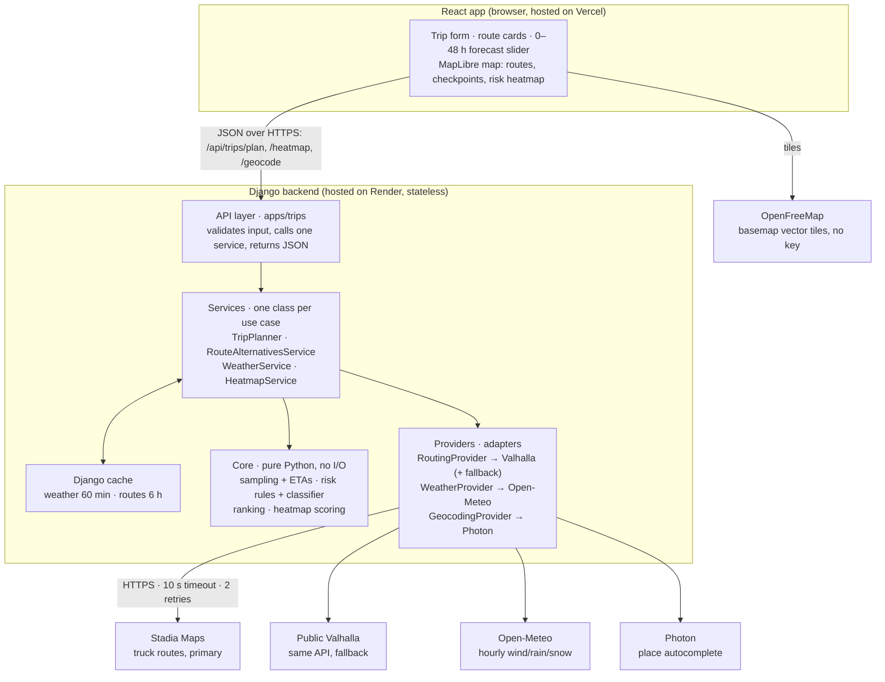

# Weather-Aware Truck Routing — Technical Design

Oct 12, 2026

## 1. Overview

We will build a React + Django web app that gives a truck driver 3 route options, scores each route's weather risk at the truck's estimated arrival time at each checkpoint, recommends the safest one, and shows everything on a map with a 0–48 hour weather heatmap. Every service used is free (free tier or open source).

**What the user enters:** origin, destination, departure date/time, load weight (lb), and a sampling interval (10 / 25 / 50 miles).

**What the app returns:**

- 3 distinct truck routes, each with distance, travel time and arrival time
- Checkpoints along each route with ETA, wind, rain, snow and a risk level
- A recommended route, with a one-line reason why it won
- A risk heatmap along the trip corridor, controlled by a 0–48 hour slider

**Design principles**

1. **Logic lives in a pure core.** Sampling, risk rules and ranking are plain Python functions with no HTTP or Django inside. They are deterministic and fully unit-tested.
2. **Every external API sits behind an interface.** Routing, weather and geocoding are "providers". Swapping Stadia for Mapbox, or Open-Meteo for a paid API, means adding one class and changing one setting.
3. **Rules are data, not if-chains.** The threshold table and load rules live in one file. Changing a threshold never touches the classifier.
4. **The backend decides; the frontend displays.** All risk and ranking logic runs on the server, so there is one source of truth.
5. **Cache first, batch always.** This keeps the app fast and inside the free limits.
6. **UTC inside, local time on screen.** All times are stored and computed in UTC; only the UI converts them.

## 2. Services and responsibilities

Each outside service has exactly one job, and only the backend talks to it (except map tiles, which the browser loads directly). All are free for this project.

| Service | Its one job | Called from | Free limit | Account / key |
| --- | --- | --- | --- | --- |
| [Stadia Maps](https://stadiamaps.com/pricing/) (hosted Valhalla) | **Truck routing:** route geometry, distance, time per maneuver, alternatives | Backend | 200,000 credits/month; a route request costs 20 credits (about 10,000 requests/month); non-commercial only | Yes: API key, no card |
| [FOSSGIS Valhalla](https://github.com/valhalla/valhalla) public server | **Routing fallback** when Stadia fails; same request format | Backend | Fair use, rate-limited | No |
| [Open-Meteo](https://open-meteo.com/en/terms) | **Weather:** hourly wind, rain and snow forecasts, up to 16 days ahead | Backend | Under 10,000 calls/day, 5,000/hour, 600/minute; non-commercial; CC-BY 4.0 credit | No |
| [Photon](https://photon.komoot.io) (komoot) | **Geocoding + autocomplete** for origin and destination | Backend proxy | Fair use; heavy use is throttled | No |
| [OpenFreeMap](https://openfreemap.org) | **Basemap tiles** (vector, MapLibre-ready) | Browser | No limits on views or requests | No |
| MapLibre GL JS + react-map-gl | **Map rendering:** routes, checkpoints, heatmap (WebGL) | Browser | Open source | No |
| Django + Django REST Framework | **API and business logic** | Server | Open source | No |
| React + Vite + TypeScript | **User interface** | Browser | Open source | No |
| [Render](https://render.com/docs/free) | **Backend hosting** | — | Free; sleeps after 15 min idle, about 1 min to wake | Yes |
| Vercel | **Frontend hosting** (static site + CDN) | — | Free hobby plan | Yes |
| GitHub (+ Actions) | **Code repository + CI** | — | Free | Yes |
| Loom | **Walkthrough video** | — | Free plan caps videos at 5 min; use the 14-day Business trial on recording day | Yes |

**Considered and rejected**

- **openrouteservice:** its free API only computes alternative routes for trips under 100 km, which rules out real truck trips.
- **Mapbox Directions:** good, but car routing only. It ignores truck weight limits. Kept as a possible extra provider.
- **Nominatim:** its usage policy forbids autocomplete.
- **Render free Postgres:** deleted after 30 days. The app is designed to need no database.
- **Stadia traffic profiles and geocoding:** these appear to be paid-plan features, so we use the plain `truck` profile and Photon instead.

## 3. System architecture

The browser talks to only two things: our Django API and the OpenFreeMap tile server. Inside Django, the core holds all risk and ranking logic and never touches the network; only the providers call outside APIs.



Arrows run from caller to callee.

**One plan request, step by step**

1. The browser sends `POST /api/trips/plan` with origin, destination, departure time, load and interval.
2. The API layer validates it and calls `TripPlanner.plan()`.
3. `RouteAlternativesService` asks the routing provider for routes until it has 3 distinct ones (Section 5.1).
4. The core places checkpoints and computes each one's ETA (Section 5.2).
5. `WeatherService` collects all checkpoint locations, removes duplicates, reads the cache, and fetches the rest from Open-Meteo in batches (Section 5.3).
6. The core classifies every checkpoint, summarises each route and ranks them (Sections 5.4–5.5).
7. The API returns routes, checkpoints, summaries and a `plan_id`. The browser then fetches the heatmap with that id (Section 6).

## 4. Backend design (Django)

The backend has four layers, and each layer may only import the layers below it: **API → Services → Core + Providers.** The core never imports Django, HTTP clients or settings, so it can be tested in milliseconds and reused anywhere.

| Layer | Folder | Responsibility | Knows about |
| --- | --- | --- | --- |
| API | `apps/trips/` | Validate input, call one service, serialize output. No logic. | Services |
| Services | `services/` | Orchestrate one use case: fetch routes, fetch weather, run the core, cache results | Core, provider interfaces |
| Core (domain) | `core/` | Pure functions and dataclasses: sampling, ETAs, risk, ranking, heatmap scoring | Nothing outside itself |
| Providers | `providers/` | Adapters that translate one outside API into core dataclasses | Core models, `httpx` |

```text
backend/
  config/
    settings/base.py, dev.py, prod.py   # env-driven settings (django-environ)
    urls.py
  apps/trips/                           # API layer (thin)
    views.py  serializers.py  urls.py
  services/                             # use cases
    trip_planner.py          # TripPlanner.plan(request) -> TripPlan
    route_alternatives.py    # 3-route pipeline (Section 5.1)
    weather_service.py       # dedupe, batch, cache weather lookups
    heatmap_service.py       # corridor grid + 48 h risk frames
  core/                                 # pure domain, no I/O
    models.py                # Coordinate, Route, Checkpoint, WeatherSample, RiskLevel, RouteSummary
    geo.py                   # haversine, interpolate, offset_point, overlap_ratio, simplify
    sampling.py              # checkpoints every N miles + ETAs
    risk/rules.py            # THRESHOLDS and LOAD_RULES as data
    risk/classifier.py       # classify(sample, load_lb) -> RiskResult
    ranking.py               # summarize() + rank()
    heatmap.py               # build_grid(), score_grid()
  providers/
    routing/base.py          # RoutingProvider protocol
    routing/valhalla.py      # one class serves Stadia AND the public server (base_url differs)
    routing/fallback.py      # FallbackRoutingProvider(primary, secondary)
    weather/base.py  weather/open_meteo.py
    geocoding/base.py  geocoding/photon.py
    registry.py              # builds providers from settings (dependency injection)
  tests/                     # mirrors the folders above
```

**Provider interfaces.** Services depend on these protocols, never on a concrete API. Tests pass in fake providers.

```python
class RoutingProvider(Protocol):
    def routes(self, origin: Coordinate, destination: Coordinate, *,
               vehicle: Vehicle, alternates: int = 0,
               preferences: RoutePreferences | None = None,
               via: Coordinate | None = None) -> list[Route]: ...

class WeatherProvider(Protocol):
    def hourly(self, points: list[Coordinate], start: datetime,
               hours: int) -> dict[GridKey, HourlySeries]: ...

class GeocodingProvider(Protocol):
    def search(self, query: str, limit: int = 5) -> list[Place]: ...
```

**Core models** are frozen dataclasses, so they are immutable and easy to compare in tests:

- `Route`: id, label, geometry, distance_mi, duration_s, and cumulative miles and seconds per geometry point
- `Checkpoint`: position, mile_marker, segment_miles, eta (UTC), `WeatherSample`, `RiskResult`
- `RiskLevel`: an `IntEnum`: LOW=0, MODERATE=1, HIGH=2, SEVERE=3, NO_TRAVEL=4, so levels can be compared and averaged
- `RiskResult`: the level plus which factor drove it (`wind`, `rain`, `snow`, `load_rule`), shown in the UI

**No database.** The API is stateless. Results live in Django's cache for an hour. If saved trips are needed later, add a new Django app with models; the core and providers stay untouched.

**Backend libraries:** Django, djangorestframework, django-cors-headers, django-environ, httpx, polyline, shapely, gunicorn, whitenoise; dev: pytest, pytest-django, respx, ruff, mypy.

## 5. Core logic

One plan request runs five steps in order: get 3 routes, place checkpoints with ETAs, fetch weather for each checkpoint's ETA hour, classify risk, then rank the routes.

### 5.1 Generating 3 routes

`RouteAlternativesService` tries the cheapest source first and stops as soon as it has 3 distinct routes:

1. **Ask for alternatives.** Valhalla `truck` costing with `alternates: 2`. Valhalla does not support alternates on time-dependent routes or routes with more than 2 locations, so we **never send `date_time`**; our own code computes ETAs from the departure time.
2. **Ask for preference variants.** Same trip with different truck costing options, e.g. `use_highways: 0.2` ("Prefers state roads") or `use_tolls: 0` ("Avoids tolls").
3. **Force a detour.** Take the midpoint of the fastest route, shift it sideways by 12% of the trip length (clamped to 20–80 km), and route origin → shifted point → destination. Try the left side, then the right.
4. **Filter every candidate.** Reject it if more than 80% of its points lie within 1 km of an accepted route (`overlap_ratio`), or if it takes more than 1.5× the fastest route's time.
5. **Still short of 3? Widen the detour.** Repeat step 3 with the shift doubled (up to 24% of trip length) — a short, single-corridor trip (e.g. a 200 mi same-interstate run) often needs a bigger shift before a detour clears the overlap filter.
6. **Still short? Reuse a rejected candidate.** Fall back to the best route filtered out in step 4 — preferring one rejected only for being slow (a genuinely different path) over one rejected for overlap — as long as it isn't a near-duplicate (>95% overlap) of a route already accepted.
7. **Label each route** by how it was produced: "Fastest", "Alternate", "Prefers state roads", "Western detour". Only if every one of the steps above still leaves fewer than 3 — meaning the road network genuinely has no third real path — does the app return fewer, with a warning instead of a fake route.

The vehicle sent to Valhalla uses the load weight converted to metric tons (lb × 0.000453592) plus an assumed empty-truck weight (Section 12). Route lines are decoded with **polyline precision 6**, which is Valhalla's format.

### 5.2 Checkpoints and ETAs

1. Decode the route and compute cumulative miles at every geometry point (haversine).
2. Build cumulative seconds per point: each Valhalla maneuver gives its `time` and its `begin_shape_index` / `end_shape_index`; spread that time over its points in proportion to distance.
3. Place a checkpoint at mile 0, every N miles (N = 10, 25 or 50, chosen by the user), and at the destination. Interpolate position and seconds between geometry points.
4. **ETA = departure time (UTC) + cumulative seconds** at that checkpoint.
5. Each checkpoint "owns" half the distance to its neighbour on each side (`segment_miles`). These always add up exactly to the route length, so risk miles are never double-counted.

### 5.3 Weather at the ETA

For each checkpoint, `WeatherService` takes the forecast hour nearest the ETA (UTC). Open-Meteo is called with `wind_speed_unit=mph`, `precipitation_unit=inch`, `timezone=GMT`, and the hourly variables `wind_speed_10m`, `wind_gusts_10m`, `rain`, `showers`, `snowfall`.

- **Wind** = `wind_speed_10m` (sustained). Gusts are shown in the popup but not used for risk.
- **Rain rate (in/hr)** = `rain + showers`. Open-Meteo reports these separately, and using `rain` alone would miss thunderstorms.
- **Snow rate (in/hr)** = `snowfall`. The code reads the unit from the response's `hourly_units` and converts cm to inches (÷ 2.54) when needed, instead of assuming.

### 5.4 Risk classification

The thresholds from the brief are stored as data in `core/risk/rules.py`. Where two levels share a boundary value, it belongs to the **higher** level; ">" bounds stay exclusive as written.

| Condition | Low | Moderate | High | Severe | No Travel |
| --- | --- | --- | --- | --- | --- |
| Wind (mph) | < 25 | ≥ 25 | ≥ 35 | ≥ 45 | ≥ 55 |
| Rain (in/hr) | < 0.10 | ≥ 0.10 | ≥ 0.25 | ≥ 0.50 | > 1.00 |
| Snow (in/hr) | < 0.5 | ≥ 0.5 | ≥ 1.0 | ≥ 2.0 | > 3.0 |

Load rules, applied after the thresholds and only ever raising the level:

| Wind | Load | Result |
| --- | --- | --- |
| ≥ 55 mph | any | No Travel |
| 45–54 mph | > 30,000 lb | No Travel |
| 35–44 mph | > 40,000 lb | Severe |

```python
def classify(sample: WeatherSample, load_lb: float) -> RiskResult:
    by_factor = {
        "wind": level_for(WIND_RULES, sample.wind_mph),
        "rain": level_for(RAIN_RULES, sample.rain_in_hr),
        "snow": level_for(SNOW_RULES, sample.snow_in_hr),
    }
    factor, level = max(by_factor.items(), key=lambda kv: kv[1])
    for rule in LOAD_RULES:                      # data, not if-chains
        if rule.matches(sample.wind_mph, load_lb) and rule.level > level:
            factor, level = "load_rule", rule.level
    return RiskResult(level=level, driver=factor)
```

### 5.5 Ranking and recommendation

`summarize()` turns each route's checkpoints into totals: miles at each level (sum of `segment_miles`), average risk (miles-weighted mean of levels 0–4), and duration. `rank()` sorts by this key, smallest first:

```python
key = (no_travel_miles, severe_miles, high_miles, round(avg_risk, 2), duration_s)
```

This is exactly the brief's order (fewest Severe miles, fewest High miles, lowest average risk, shortest time), with No Travel miles placed first (Section 12). The reason line compares the winner with the runner-up on the first key that differs, e.g. "Recommended: 0 severe miles vs 42 on the Fastest route." If every route has No Travel miles, the app still ranks them but shows a red "Do not travel at this departure time" banner.

## 6. Weather heatmap and 0–48 h slider

The heatmap is computed once per plan on the server, and the slider only switches between 49 precomputed frames (hours 0 to 48) in the browser, with no network calls. This makes the slider smooth.

**Building the corridor grid (`core/heatmap.py`)**

1. Take the bounding box of all 3 routes and expand it by 30 miles.
2. Lay a regular grid over it, choosing the spacing so there are at most about 225 points (15 × 15), with a floor of 0.1°.
3. Keep only grid points within 40 miles of at least one route. This is the "trip corridor" the brief asks for, and it saves weather calls.

**Scoring each point (`HeatmapService`)**

1. Fetch hourly weather for all corridor points in batched requests, starting at the departure hour, for 49 hours. These share the same cache as the checkpoints (Section 9).
2. For every point and every hour, run the same `classify()` with the user's load weight. The heatmap therefore shows risk **for this truck and this load**, not raw weather.
3. Return compact arrays: one list of points and a 49 × N grid of risk levels (0–4), plus raw wind, rain and snow values for hover tooltips.

**Slider behaviour (frontend)**

- Hour 0 = departure time. The label shows the clock time, e.g. "+6 h · Tue 14:00".
- Moving the slider updates one GeoJSON source with that hour's weights (risk ÷ 4), throttled to one update per animation frame.
- A small truck marker on each route shows where the truck will be at that hour, linking the heatmap to the ETAs.
- Colours follow the risk scale used everywhere: Low green, Moderate yellow, High orange, Severe red, No Travel purple, with a legend.

**Loading:** the plan response returns route results first. The heatmap is fetched by a separate request (`GET /api/trips/{plan_id}/heatmap`), so the routes appear on the map without waiting for the grid.

## 7. Frontend design (React)

The frontend is organised by feature. Each feature folder owns its components, so changing the form never touches the map. All API types live in one file that mirrors the API contract (Section 8).

```text
frontend/src/
  api/
    client.ts            # fetch wrapper: base URL, JSON, typed errors
    types.ts             # TripPlanRequest, TripPlan, RouteResult, Checkpoint, Heatmap
    hooks.ts             # useTripPlan(), useHeatmap(), usePlaceSearch() via TanStack Query
  features/
    trip-form/           # TripForm, PlaceAutocomplete, IntervalSelector, validation.ts
    routes/              # RouteList, RouteCard, RecommendationBanner, RiskBar
    map/                 # TripMap + layers/: RouteLayer, CheckpointLayer, HeatmapLayer,
                         #   TruckPositionLayer; CheckpointPopup, Legend
    forecast/            # ForecastSlider
  state/uiStore.ts       # selected route, slider hour, panel open (Zustand)
  lib/
    risk.ts              # one place for risk colours and labels
    format.ts            # miles, durations, UTC -> local time
  App.tsx                # layout: side panel + map
```

**State.** Server data (plans, heatmaps, place search) lives in TanStack Query, which gives caching, loading and error states. UI-only state (selected route, slider hour) lives in a small Zustand store. Nothing is duplicated between the two.

**Layout.** A left panel holds the form, the recommendation banner and 3 route cards. The map fills the rest. On phones the panel becomes a bottom sheet.

**Route card** shows: label, distance, duration, arrival time, a stacked bar of miles per risk level, and the "why" line for the recommended route. Clicking a card highlights that route and fits the map to it.

**Map layers, bottom to top:**

1. OpenFreeMap basemap (light "positron" style, so risk colours stand out)
2. Heatmap layer (MapLibre native `heatmap` type)
3. Route lines: recommended route thick and coloured, others thinner and grey; the selected route is brought forward
4. Checkpoint circles coloured by risk level; click opens a popup with mile marker, ETA (local time), wind, gusts, rain, snow, level and the factor that caused it
5. Truck position markers for the current slider hour

**Map performance rules**

- Every layer is a declarative `<Source>` + `<Layer>` with memoised GeoJSON, so React re-renders never rebuild the map.
- Route lines arrive already simplified by the server (about 500 points each).
- The slider changes only the heatmap and truck-marker data; route and checkpoint sources stay untouched.

**Form validation** (client-side, repeated on the server): both places chosen from autocomplete; departure not in the past and within the forecast window; load weight 1–80,000 lb; interval 10, 25 or 50.

**Frontend libraries:** react, react-dom, maplibre-gl, react-map-gl, @tanstack/react-query, zustand, tailwindcss; dev: typescript (strict), vite, eslint, prettier, vitest.

## 8. API contract

The backend exposes four JSON endpoints under `/api/`. All times are ISO 8601 in UTC; distances are in miles.

| Method | Path | Purpose |
| --- | --- | --- |
| GET | `/api/geocode?q=` | Place autocomplete (proxies Photon, cached 24 h) |
| POST | `/api/trips/plan` | Routes, checkpoints, risk, recommendation |
| GET | `/api/trips/{plan_id}/heatmap` | 49 hourly risk frames for the corridor |
| GET | `/api/health` | Health check, also used to wake the server |

**`POST /api/trips/plan` request**

```json
{
  "origin":      { "lat": 41.8781, "lon": -87.6298, "label": "Chicago, IL" },
  "destination": { "lat": 39.7392, "lon": -104.9903, "label": "Denver, CO" },
  "departure_time": "2026-10-13T00:30:00Z",
  "load_weight_lb": 38000,
  "interval_miles": 25
}
```

**Response (shortened)**

```json
{
  "plan_id": "a1b2c3",
  "recommended_route_id": "r2",
  "recommendation_reason": "0 severe miles vs 42 on the Fastest route",
  "warnings": [],
  "routes": [{
    "id": "r2", "label": "Prefers state roads",
    "geometry": { "type": "LineString", "coordinates": [[-87.63, 41.88], "..."] },
    "distance_mi": 1012.4, "duration_s": 55800,
    "arrival_time": "2026-10-13T16:00:00Z",
    "summary": {
      "miles_by_level": { "low": 801.2, "moderate": 160.0, "high": 51.2, "severe": 0, "no_travel": 0 },
      "avg_risk": 0.26, "max_level": "high"
    },
    "checkpoints": [{
      "mile": 25, "lat": 41.70, "lon": -88.05, "eta": "2026-10-13T01:00:00Z",
      "wind_mph": 18.2, "gust_mph": 27.0, "rain_in_hr": 0.02, "snow_in_hr": 0.0,
      "risk": "low", "driver": "wind", "segment_miles": 25
    }]
  }]
}
```

**Errors** use one shape, `{ "error": { "code": "...", "message": "...", "fields": {} } }`:

- `400 validation_error`: bad input, with per-field messages
- `422 no_route`: no truck route exists between the points
- `502 provider_error`: an outside API failed after retries and fallback

Changing the interval re-sends the plan request. It is cheap, because routes and weather come from the cache.

## 9. Free-tier budget, caching and scalability

Open-Meteo's 10,000 calls per day is the tightest limit, so weather is deduplicated, batched and cached; routing has plenty of room.

**Budget per new trip plan (estimates)**

| Service | Calls per new plan | Free allowance | New plans it supports |
| --- | --- | --- | --- |
| Stadia routing | 1–5 requests × 20 credits = up to 100 credits | 200,000 credits/month | about 2,000 per month |
| Open-Meteo | up to about 400 location-lookups (checkpoints + heatmap, after dedupe) | 10,000/day | about 25 per day uncached; repeats are free |
| Photon | about 5–10 searches while typing | fair use | not a constraint with debounce |

It is not documented clearly how Open-Meteo counts a request with many locations, so the budget assumes **each location counts as one call**. If it counts per request, there is much more room.

**Caching (Django cache framework)**

| Data | Cache key | Lifetime |
| --- | --- | --- |
| Weather series | lat/lon rounded to 0.1° (about 7 miles) + forecast start hour | 60 min |
| Routes | origin, destination, truck weight, preferences | 6 h |
| Plan + heatmap corridor | `plan_id` | 60 min |
| Geocoding | normalised query text | 24 h |

Rounding to 0.1° lets the 3 routes, the checkpoints and the heatmap share weather lookups. Open-Meteo's models run at 1–11 km resolution, so a 0.1° (about 11 km) cell loses very little accuracy.

**Reliability**

- Every outside call has a 10 s timeout and 2 retries with backoff.
- Routing falls back from Stadia to the public Valhalla server automatically (`FallbackRoutingProvider`).
- Independent calls (route variants, weather batches) run in parallel with a thread pool.
- Public free servers get a client-side rate limiter (1 request/second) and a descriptive `User-Agent`.

**How it scales later (no rewrite needed)**

| Need | Change | Code touched |
| --- | --- | --- |
| More traffic | Run more Django instances; the API is stateless | None |
| Shared cache across instances | Point `CACHES` at Redis | Settings only |
| Heavier heatmaps | Move `HeatmapService` into a Celery task | One service |
| Paid or self-hosted APIs | Add a provider class; set `ROUTING_PROVIDER` / `WEATHER_PROVIDER` | One new file + env |
| Saved trips, users | New Django app with models + Postgres | New app only |
| New hazard (fog, ice) | Add a field to `WeatherSample` + a rule row | `rules.py`, `models.py`, provider |

## 10. Code quality, testing and conventions

The rules are enforced by tools in CI, not by memory: every push runs linting, type checks and tests on GitHub Actions.

**Conventions**

| Area | Backend (Python) | Frontend (TypeScript) |
| --- | --- | --- |
| Formatting + lint | ruff (lint + format) | ESLint + Prettier |
| Types | type hints everywhere; mypy strict on `core/` | `strict: true` in tsconfig |
| Naming | `snake_case`, units in names (`wind_mph`, `duration_s`) | `camelCase`, components in `PascalCase` |
| Config | env vars via django-environ; no secrets in code | `VITE_API_BASE_URL` only; no API keys in the browser |
| Errors | typed exceptions (`ProviderError`, `NoRouteError`) mapped to the error shape in one place | one `ApiError` type; every query shows loading and error states |
| Logging | structured logs with provider name, latency, cache hit | — |

**Rules for clean code**

- Functions do one thing and stay short; anything with a branch has a test.
- No magic numbers: thresholds, intervals, offsets and cache lifetimes are named constants or settings.
- Views stay thin: validate, call one service, return.
- The core receives everything it needs as arguments (including the current time), so tests never depend on the clock or the network.

**Tests**

| What | How | Examples |
| --- | --- | --- |
| Risk thresholds | `pytest.mark.parametrize` over every boundary | wind 24.9 → Low, 25 → Moderate; rain 0.25 → High; rain 1.00 → Severe, 1.01 → No Travel |
| Load rules | table of wind × load cases | 40 mph + 40,000 lb → High; 40 mph + 40,001 lb → Severe; 50 mph + 30,001 lb → No Travel |
| Sampling | synthetic straight-line route | checkpoint count, mile markers, ETAs always increasing, `segment_miles` sum = route length |
| Ranking | hand-built summaries | each of the 4 tie-breakers decides one case; No Travel ranks last |
| 3-route pipeline | fake `RoutingProvider` | duplicates rejected, slow routes rejected, honest result when only 2 exist |
| Providers | `respx` mocks of recorded API responses | polyline precision 6 decoded correctly; cm → inch snow conversion |
| API | DRF test client with fake providers | 400 on bad input, 502 on provider failure, response matches the contract |
| Frontend | vitest | risk colour mapping, time formatting |

**Making changes safely: where each kind of change goes**

- Change a threshold → `core/risk/rules.py` only, plus its test row.
- Switch the routing API → new file in `providers/routing/`, one env var.
- Change ranking priorities → the sort key in `core/ranking.py`.
- Change colours or labels → `frontend/src/lib/risk.ts`.

## 11. Requirement traceability

Every line of the assignment brief maps to a module and a way to prove it works.

| Brief requirement | How we meet it | Where | Proof |
| --- | --- | --- | --- |
| React + Django web app | React/Vite/TS frontend, Django/DRF backend | `frontend/`, `backend/` | Hosted app |
| Input: origin and destination | Photon autocomplete via `/api/geocode` | `trip-form/PlaceAutocomplete` | UI demo |
| Input: departure date/time | Date-time picker, validated against forecast window, sent as UTC | `trip-form/validation.ts`, serializer | Validation tests |
| Input: load weight | lb field; used for Valhalla truck weight and load rules | `TripForm`, `classifier.py` | Load-rule tests |
| 3 route options via routing API | Valhalla alternates → preference variants → detours, with dedupe | `route_alternatives.py` | Pipeline tests with fake provider |
| Sample weather every 10 / 25 / 50 miles | Interval selector; checkpoints placed along route geometry | `core/sampling.py` | Sampling tests |
| Weather at ETA at each checkpoint | ETA from per-maneuver times; forecast hour nearest ETA | `sampling.py`, `weather_service.py` | ETA tests; popup shows ETA + values |
| Risk from provided rules | Rule table as data; boundary rule documented | `core/risk/` | Boundary tests |
| Load rules | Escalation rules applied after thresholds | `core/risk/rules.py` | Load-rule tests |
| Recommend best route (risk vs time) | Sort key in brief's priority order + reason line | `core/ranking.py` | Ranking tests; banner in UI |
| Map: routes, checkpoints, risk, ETAs, summaries | Route lines, coloured checkpoints, popups, route cards | `features/map/`, `features/routes/` | Loom demo |
| Weather heatmap along the corridor | Corridor-masked grid scored with the same classifier | `core/heatmap.py`, `HeatmapLayer` | Loom demo |
| 0–48 h forecast slider | 49 precomputed frames; slider swaps data only | `ForecastSlider`, `HeatmapLayer` | Smooth in demo |
| Third-party APIs allowed | Stadia, Open-Meteo, Photon, OpenFreeMap | `providers/` | README |
| GitHub repository | Monorepo with README and CI | GitHub | Link |
| Hosted application | Vercel (frontend) + Render (backend) | — | Link |
| 5–10 min Loom walkthrough | Script in Section 13 | — | Link |
| Prioritise correctness and clarity | Pure, tested core; documented assumptions | `core/`, Section 12 | Test suite |

**Mapped to the grading weights**

- **40% routes, weather, risk, recommendation:** Sections 5 and 6, covered by the core test suite.
- **35% UI, map, heatmap smoothness:** WebGL map, precomputed heatmap frames, memoised layers (Section 7).
- **10% code quality:** layered design, typed code, CI (Sections 4 and 10).
- **5% documentation and walkthrough:** README and Loom (Section 13).

## 12. Assumptions and ambiguity decisions

The brief leaves a few points open. Each decision below is made once, coded in one place, and repeated in the README.

| # | Open point in the brief | Decision | Reason |
| --- | --- | --- | --- |
| 1 | Shared range endpoints (wind 25, rain 0.25, snow 1.0 appear in two levels) | A shared value belongs to the higher level; ">" bounds stay exclusive | Safer for a safety tool; one consistent rule |
| 2 | No Travel is not in the ranking list | Rank by No Travel miles first, then the brief's 4 criteria; show a red banner | A route with No Travel miles can never be "safest" |
| 3 | "Load weight" vs truck weight | Load rules use the entered load. Valhalla gets load + 35,000 lb assumed empty truck weight | Rules are written for load; road limits apply to gross weight |
| 4 | Which rain field | Rain rate = `rain` + `showers` | `rain` alone misses convective storms |
| 5 | Wind speed vs gusts | Risk uses sustained wind; gusts shown only | The brief's thresholds read as sustained speeds |
| 6 | Slider hour 0 | Hour 0 = departure time | The app plans a future trip, so departure is the natural anchor |
| 7 | Driver rest breaks | Not modelled; ETAs assume continuous driving at Valhalla truck speeds | Not in the brief; noted as a future improvement |
| 8 | Weight given to each checkpoint | Half the distance to each neighbour (`segment_miles`) | Miles add up exactly to route length |
| 9 | Fewer than 3 distinct routes exist | Widen the detour shift (up to 2x) and, failing that, fall back to the best previously-rejected candidate (never the literal same path twice — see `backend/README.md` Section 5.1) before accepting fewer than 3. Only a warning if the road network truly has no third real path. | Revised from an earlier "never fabricate a 3rd route" decision after product testing: a short, single-corridor trip (e.g. a 200 mi same-interstate run) was too often landing at 2 routes under the stricter rule. The app always shows 3 when the road network offers that much raw material. |
| 10 | Departure too far ahead | Reject when departure + trip time goes past the 16-day forecast | No forecast data exists beyond that |

## 13. Deployment, configuration and deliverables

The repo is one monorepo; the frontend deploys to Vercel and the backend to Render, both automatically on push to `main`.

```text
weather-truck-routing/
  backend/      # Django project (Section 4)
  frontend/     # React app (Section 7)
  docs/         # this design, screenshots, architecture image
  .github/workflows/ci.yml
  README.md
```

**Environment variables**

| Variable | Where | Example / purpose |
| --- | --- | --- |
| `STADIA_API_KEY` | Render | Stadia routing key (server only) |
| `ROUTING_PROVIDER` | Render | `valhalla` |
| `ROUTING_PRIMARY_URL` | Render | `https://api.stadiamaps.com` |
| `ROUTING_FALLBACK_URL` | Render | `https://valhalla1.openstreetmap.de` |
| `WEATHER_PROVIDER` | Render | `open_meteo` |
| `GEOCODER_URL` | Render | `https://photon.komoot.io` |
| `ASSUMED_EMPTY_TRUCK_LB` | Render | `35000` |
| `DJANGO_SECRET_KEY`, `ALLOWED_HOSTS`, `CORS_ALLOWED_ORIGINS` | Render | standard Django security settings |
| `VITE_API_BASE_URL` | Vercel | the Render backend URL |

**Hosting notes**

- Backend runs with `gunicorn`; `whitenoise` serves admin static files. Cache = local memory (switch to Redis by setting only).
- Render's free instance sleeps after 15 minutes. The frontend calls `/api/health` on page load to start waking it, and shows "Waking up the server…" while it does. Open the app yourself a minute before a reviewer does.
- Map attribution must credit OpenStreetMap, OpenMapTiles/OpenFreeMap, Stadia Maps and Open-Meteo (CC-BY 4.0).

**Build order**

1. Core: models, risk rules + tests, sampling + tests, ranking + tests
2. Providers: Valhalla, Open-Meteo, Photon, with mocked tests
3. Services: 3-route pipeline, weather batching and cache, trip planner, heatmap
4. API endpoints + contract tests
5. Frontend: form, route cards, map layers, slider
6. Deploy both apps, then polish UI and write the README
7. Record the Loom

**README contents:** what the app does; screenshot or GIF; live link; architecture diagram; services and why each was chosen; how risk and ranking work; assumptions (Section 12); local setup (`make dev` or two commands); running tests; known limitations.

**Loom script (about 8 minutes)**

1. **0:00–1:00** The problem and a live plan request (e.g. a long trip with weather on the way)
2. **1:00–3:00** The 3 routes, checkpoints, popups, recommendation and its reason
3. **3:00–4:00** Heatmap and slider; truck markers moving with the hours; change the load to show the load rules
4. **4:00–6:00** Code tour: layers, provider interfaces, rules-as-data, the 3-route pipeline
5. **6:00–7:00** Tests running; boundary and load-rule cases
6. **7:00–8:00** Assumptions, free-tier choices, and what you would add next

**Accounts to create:** Stadia Maps (API key), GitHub, Render, Vercel. Create the Loom account on recording day so its 14-day trial covers the recording.

**Sources**

- [Stadia Maps pricing and credit costs](https://stadiamaps.com/pricing/) · [Stadia service limits](https://docs.stadiamaps.com/limits)
- [Valhalla project and public demo server](https://github.com/valhalla/valhalla) · [Valhalla `alternates` limits](https://github.com/valhalla/valhalla/pull/4506.diff)
- [Open-Meteo terms and free limits](https://open-meteo.com/en/terms)
- [OpenFreeMap](https://openfreemap.org) · [Photon](https://wiki.openstreetmap.org/wiki/Photon)
- [openrouteservice restrictions](https://openrouteservice.org/restrictions/)
- [Render free tier](https://render.com/articles/platforms-with-a-real-free-tier-for-developers-in-2026) · [Loom free plan limits](https://costbench.com/software/communication/loom)